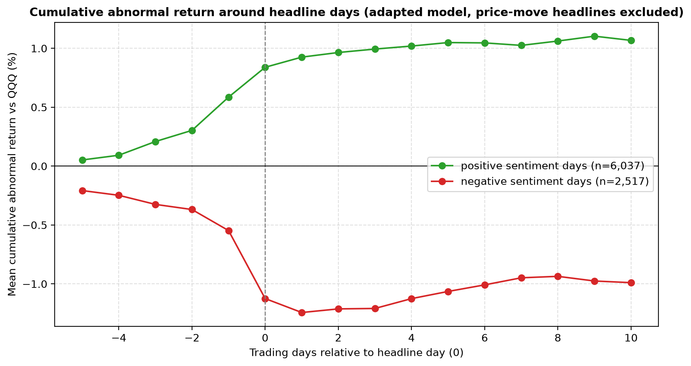

# Live Financial News Sentiment Monitor for the Nasdaq-100

[](https://github.com/Sarthakm20/time-aware-financial-news-monitor/actions/workflows/ci.yml)

> **Important Limitation & Disclaimer:**  
> This project is a research and news‑triage prototype. Its sentiment scores summarize the tone of dated financial‑news coverage; they **do not predict stock returns, provide trading signals, or constitute investment advice**. FNSPID’s historical dataset ends in 2023; the live feed (Phase 5, see *Live news feed*) adds current, timestamped headlines from free sources.

---

## Quick Overview – Four Core Questions

1. **What does this do?**  
   *It fine‑tunes a lightweight DistilBERT model on the Financial PhraseBank, evaluates it against a zero‑shot NLI baseline, and then applies the model to historical company news to produce time‑aware sentiment summaries.*

2. **How do I run it?**  
   ```bash
   # Clone the repo
   git clone https://github.com/Sarthakm20/time-aware-financial-news-monitor.git
   cd time-aware-financial-news-monitor

   # Set up Python environment (Windows PowerShell shown)
   python -m venv .venv
   .\.venv\Scripts\Activate.ps1
   pip install -r requirements.txt

   # Reproduce the pipeline from the command line (see "Command-Line Pipeline" below)
   python -m src.pipeline --list
   python -m src.pipeline prepare evaluate score monitor

   # Interactive dashboard and REST API (see "Apps & Deployment" below)
   streamlit run app/streamlit_app.py
   uvicorn src.api:app --port 8000          # docs at http://localhost:8000/docs
   ```
   *The notebooks (execution order below) document the research step by step; `python -m src.pipeline` is the reproducible path built on the same `src/` code.*

3. **What did you find?**  
   *The fine‑tuned DistilBERT achieves **85.40% accuracy** (Macro F1 **0.8388**) versus **50.00% accuracy** (Macro F1 **0.5299**) for the zero‑shot BART‑MNLI baseline. In a case study on Tesla headlines (2019–2023), headlines in the most recent 30 days average **+0.1238**, against **+0.0238** across all five years (both unweighted).*  
   *The most important finding: on 230 annotated real TSLA headlines, macro F1 falls from **0.839 to 0.496**, and no model beats always predicting "neutral" on accuracy. Sentence-level benchmark scores substantially overstate performance on headlines (see Results §5).*  
   *Across **24,807 company-days for 85 Nasdaq-100 stocks**, positive-headline days outperform negative ones by **+1.2% on the same day**, but the gap is already **+0.5% the day before**, and there is no significant drift over the following week. The headlines largely *describe* price moves rather than predict them (Results §7).*
   *Phase 5: an int8 ONNX export runs **6.9× faster (2.9 vs 20.2 ms per headline) in a fifth of the RAM** with unchanged accuracy, and a key-free live feed now scores this week's headlines for all 89 tickers (Results §9).*  

4. **What would you do next with more time?**  
   * • Collect *timestamped* news (FNSPID has dates only), to separate after-hours news from genuine next-day predictability.  
   * • Have a human verify the LLM-annotated headline labels, and grow the headline training set.  
   * • Expand the training data beyond the ~4.8k‑sentence Financial PhraseBank.  
   * • Explore larger transformer architectures and longer fine‑tuning schedules to test diminishing returns.  
   * • ~~Integrate a real-time news API and an online monitoring dashboard with alert thresholds~~ (done in Phase 5: live feed, alerts, Gemini live accuracy check).  
   * • Conduct a thorough statistical analysis to assess significance of sentiment shifts across windows.

---

## Honest Accounting of Fine‑Tuning Gains

The zero‑shot BART‑MNLI baseline reached **50.00% accuracy**, below the 59% a model would get by always predicting the majority class (neutral), and it struggled most with neutral text (0.325 F1). Fine‑tuning DistilBERT on domain‑specific data lifted accuracy by **35.4 percentage points** and macro F1 by **0.31**, a large, practically meaningful improvement.

The zero‑shot baseline is also **prompt‑sensitive**: an alternative hypothesis template (`"This text expresses {} financial sentiment."`) scored only 45.18% accuracy / 0.4747 macro F1 on the same split. All reported baseline numbers use the single template in `src/config.py` (`ZERO_SHOT_HYPOTHESIS_TEMPLATE`).

The compute cost was modest: a single 2‑epoch training run took ~5–7 minutes on a GPU (or ~50 minutes on CPU). Therefore, the fine‑tuning effort was **well‑justified**; the performance uplift far exceeds the tiny compute investment.

---

## Reported Failures, Trade-offs & Limitations

- **Dataset size:** The Financial PhraseBank (50% agreement) contains only ~4.8k sentences, limiting the model’s exposure to diverse financial language. This small size is a known constraint and explains why further gains may plateau without additional data.
- **Class Imbalance & Weighted-Loss Trade-Off:** The PhraseBank is heavily skewed toward neutral sentences (59% neutral, 28% positive, 13% negative). On implementing balanced class-weighted loss training to address this skew, the **minority negative class F1 improved from 0.8394 to 0.8601**. However, this came at the expense of overall accuracy (dropping from 85.40% to 80.44%) and neutral F1 (dropping from 0.8871 to 0.8282). This honest negative trade-off confirmed that standard unweighted fine-tuning remains the superior all-round model for general news triage. (Both saved models are epoch-2 checkpoints; the weighted run's learning-rate schedule spanned 3 epochs, so the comparison is close to, but not exactly, like-for-like. The config now trains both for 2 epochs.)
- **Domain shift (measured, large):** The classifier is trained on PhraseBank sentences but applied to news *headlines*. On 230 annotated TSLA headlines its macro F1 is 0.496 vs 0.839 on PhraseBank (Results §5), so **the TSLA sentiment timeline should be read as a rough tone indicator, not a precise measurement.**
- **Annotation provenance:** The headline labels were produced by an LLM annotator (Claude), following `docs/annotation_guidelines.md`, and have **not yet been verified by a human**. Treat the headline results as provisional; a human pass (or a second annotator for inter-annotator agreement) would strengthen them.
- **Ticker tagging noise:** 65 of 300 sampled "TSLA" headlines (21.7%) are not about Tesla at all (other companies, crypto, personal finance). They are excluded from the headline evaluation but *are* included in the monitoring timeline.
- **FNSPID coverage:**
  - The Nasdaq-100 slice keeps **exactly one headline per company per day**, so a "daily sentiment" is one headline's score.
  - **13 of 89 tickers have gaps longer than 90 days, almost all starting 10 June 2020.** The large caps are hit hardest: AMZN is missing 1,002 days, AAPL 723, TSLA 691 (Jun 2020 – May 2022) and NVDA 433. GILD and SBUX are essentially complete.
  - Treat these stretches as missing data, not quiet news. The dashboard warns when a selected company has one.
- **Recency weighting on long windows:** With a 30-day half-life, headlines older than ~6 months carry under 2% weight, so the recency-weighted score is nearly identical for the 180-day, 365-day and all-history windows (~+0.10). Compare unweighted means across windows, and weighted vs unweighted within a window.
- **Data Freshness:** The open-source FNSPID dataset covers historical news up through late 2023. Consequently, all demonstrated timelines reflect historical research rather than live real-time feeds.
- **Scope & Non-Advisory:** It is meant to summarize tone in financial reporting. It does not predict stock prices or asset returns, and does not constitute trading signals or investment advice.
- **Input Scope:** This implementation classifies article headlines rather than full article bodies.

---

## Key Results & Evidence

### 1. Overall Model Comparison (Held-out Test Split, N=726)

| Metric | Zero‑Shot Baseline  | Fine‑Tuned DistilBERT | Improvement |
|:---|:---:|:---:|:---:|
| **Accuracy** | 50.00% | **85.40%** | **+35.40 pp** |
| **Macro F1** | 0.5299 | **0.8388** | **+0.3089** |
| **Negative F1** | 0.7063 | **0.8394** | +0.1331 |
| **Neutral F1** | 0.3250 | **0.8871** | **+0.5621** |
| **Positive F1** | 0.5583 | **0.7900** | +0.2317 |

*Sources: `outputs/metrics/zero_shot_test_metrics.json` and `outputs/metrics/finetuned_test_metrics.json`. The general-domain NLI zero-shot model fails most on financial neutrality (0.325 F1); fine-tuning DistilBERT on domain text pushes neutral F1 to 0.8871.*

### 2. Per-Class F1 & Class-Weighted Loss Experiment

To investigate the label imbalance (neutral dominance vs sparse negatives), we trained a third model using balanced class weights (`weights = [2.67, 0.56, 1.18]` for negative, neutral, and positive respectively):

| Class | Zero-Shot F1 | Fine-Tuned F1 (Standard) | Weighted-Loss Fine-Tuned F1 |
|:---|:---:|:---:|:---:|
| **Negative** | 0.7063 | 0.8394 | **0.8601** |
| **Neutral** | 0.3250 | **0.8871** | 0.8282 |
| **Positive** | 0.5583 | **0.7900** | 0.7432 |
| **Overall Accuracy** | 0.5000 | **0.8540** | 0.8044 |
| **Macro F1** | 0.5299 | **0.8388** | 0.8105 |

*Weighted-loss numbers: `outputs/metrics/weighted_test_metrics.json`.*

* Visualizations generated in `outputs/figures/`:
  - `per_class_f1_baseline_vs_finetuned.png`
  - `per_class_f1_standard_vs_weighted.png`

### 3. Time-Aware Monitoring Case Study: Tesla (`TSLA`, 2019–2023)

Evaluated across 872 dated news headlines from FNSPID:

$$\text{Sentiment Score} = P(\text{Positive}) - P(\text{Negative}) \in [-1.0, +1.0]$$
$$\text{Recency Weight} = 2^{-\Delta t / 30} \quad (\text{Half-life} = 30 \text{ days})$$

| Lookback Window | Headline Count | Unweighted Sentiment | Recency-Weighted Sentiment | % Positive | % Neutral | % Negative |
|:---|:---:|:---:|:---:|:---:|:---:|:---:|
| **Last 30 days** | 30 | **+0.1238** | **+0.1474** | 16.67% | 76.67% | 6.67% |
| **Last 180 days** | 178 | +0.0655 | +0.1019 | 15.17% | 73.60% | 11.24% |
| **Last 365 days** | 362 | +0.0400 | +0.1017 | 16.02% | 69.34% | 14.64% |
| **All History (5 Years)** | 872 | +0.0238 | +0.1017 | 14.45% | 69.38% | 16.17% |

*Source: `outputs/metrics/tsla_sentiment_window_summary.csv`. Read the unweighted column across windows: coverage in the latest 30 days (+0.12) is more positive than the five-year average (+0.02). The weighted column converges to ~+0.10 for long windows because of the 30-day half-life (see Limitations).*

### 4. Rigorous Evaluation: Uncertainty, Significance, Calibration, Stronger Baseline

Single accuracy numbers on 726 sentences hide how much they could move. Every model below was re-scored with **95% bootstrap confidence intervals** (2,000 resamples), compared with the fine-tuned DistilBERT on the *same* sentences using **McNemar's exact test**, and checked for **calibration** (expected calibration error, ECE).

| Model (test split, N=726) | Macro F1 [95% CI] | Accuracy [95% CI] | ECE | vs DistilBERT (McNemar *p*) |
|:---|:---:|:---:|:---:|:---:|
| **DistilBERT fine-tuned** (ours) | **0.839** [0.807, 0.866] | **85.4%** [82.6, 87.7] | **0.021** | (reference) |
| DistilBERT, class-weighted loss | 0.811 [0.779, 0.840] | 80.4% [77.4, 83.2] | 0.069 | **0.0001**: significantly worse |
| FinBERT (`ProsusAI/finbert`, off-the-shelf)† | 0.894 [0.867, 0.917] | 89.9% [87.7, 92.2] | 0.027 | 0.0002† |
| Zero-shot BART-MNLI | 0.530 [0.496, 0.566] | 50.0% [46.3, 53.7] | 0.113 | < 10⁻⁶ |
| Always predict "neutral" | 0.248 | 59.4% [55.8, 63.0] | – | < 10⁻⁶ |

† **FinBERT was itself fine-tuned on Financial PhraseBank**, so it has very likely seen many of these test sentences. Its higher score here is not a fair win. The fair comparison is on data neither model trained on (the headline evaluation below).

**Findings**
1. **Fine-tuning gain is real and large:** +0.31 macro F1 over zero-shot, with non-overlapping CIs. Zero-shot BART-MNLI is *below* the trivial always-neutral baseline in accuracy (50.0% vs 59.4%).
2. **Class-weighted loss is significantly worse** overall (*p* = 0.0001). The earlier conclusion holds statistically, not just numerically.
3. **DistilBERT is already well calibrated** (ECE 0.021). Temperature scaling fitted on the validation split gives T = 1.07 and does not improve the test split (ECE 0.0216, NLL 0.365 → 0.365), so no recalibration is applied. The probabilities behind the P(pos) − P(neg) score can be read at face value, at least on in-domain sentences. Reliability diagram: `outputs/figures/finetuned_reliability_diagram.png`.
4. **Evidence of domain shift, before any hand labels:** DistilBERT and FinBERT agree on **89.0%** of PhraseBank test sentences (Cohen's κ = 0.81) but only **77.5%** of the 872 real TSLA headlines (κ = 0.57). FinBERT also labels 24.5% of headlines negative vs DistilBERT's 16.2%. At least one model degrades on headlines; the hand-labelled set (below) measures which, and by how much.

*Sources: `outputs/metrics/test_set_model_comparison.csv`, `outputs/metrics/test_set_analysis.json`, `outputs/metrics/finbert_test_metrics.json`.*

### 5. In-Domain Evaluation on Real Headlines: Large Domain Shift

PhraseBank sentences are not what the monitor actually scores. To measure performance where it matters, 300 TSLA headlines were sampled **blind** (no model output shown) and stratified by year, then annotated following `docs/annotation_guidelines.md` ("good, bad or neither news *for Tesla*?"). 230 received a sentiment label (133 neutral, 56 positive, 41 negative); 65 were **off-topic** (not about Tesla) and 5 unclear.

> ⚠️ **Annotation provenance:** these labels were produced by an **LLM annotator (Claude)**, not a human, and are recorded as such in `data/labelled/tsla_headlines_gold.csv` (`annotator` column). They have not yet been human-verified, so treat the numbers below as provisional.

| Model (N=230 annotated headlines) | Macro F1 [95% CI] | Accuracy | vs DistilBERT (McNemar *p*) | *Company-specific only (N=196)*: Macro F1 |
|:---|:---:|:---:|:---:|:---:|
| DistilBERT fine-tuned | 0.496 [0.421, 0.564] | 57.4% | (reference) | 0.551 [0.470, 0.631] |
| DistilBERT class-weighted | 0.546 [0.477, 0.613] | 58.3% | 0.86 | 0.606 [0.531, 0.680] |
| FinBERT (off-the-shelf) | 0.508 [0.435, 0.576] | 55.7% | 0.67 | 0.572 [0.498, 0.644] |
| Always predict "neutral" | 0.244 | **57.8%** | 1.00 | 0.225 |

**Findings**
1. **Headline performance is far below benchmark performance.** DistilBERT drops from **0.839 → 0.496 macro F1 (−0.34)**, and on accuracy no model beats always predicting "neutral". The fall is mostly on the polar classes: positive recall is just 0.27, e.g. *"Here's Why Tesla Stock Popped Today"* → neutral, and *"Tesla Is 'Crushing The Auto Industry'"* → negative.
2. **The drop is not an artefact of the labelling convention.** The guidelines label market-wide headlines ("Wall Street surges…") neutral *for Tesla*, while models score their general tone. Removing those 34 headlines raises DistilBERT only to 0.551, still **~0.29 below** its benchmark score. On company-specific headlines all models do beat the majority class (61% vs 51% accuracy).
3. **FinBERT's benchmark lead disappears on unseen data** (0.894 → 0.508, no better than DistilBERT, *p* = 0.67). This supports the contamination explanation for its test-split score.
4. **Model ranking flips:** the class-weighted model, significantly worse on PhraseBank, is the best of the three on headlines (0.546; 0.606 company-specific), because headlines contain proportionally more polar news. The difference is not significant at N=230, but it suggests weighting is worth revisiting for the deployed use case.
5. **Data quality:** 21.7% of sampled "TSLA" headlines are not about Tesla. A relevance filter would remove noise from the monitoring timeline.

*Sources: `outputs/metrics/tsla_headline_evaluation.json`, `outputs/metrics/tsla_headline_model_comparison.csv`. Reproduce: `python -m src.pipeline evaluate-headlines`.*

### 6. Seed Variation: The Result Is Not a Lucky Seed

DistilBERT was retrained from scratch with different random seeds (same data, same 2-epoch recipe) and each run was scored on the same test split:

| Seed | Accuracy | Macro F1 | Negative F1 | Neutral F1 | Positive F1 |
|:---:|:---:|:---:|:---:|:---:|:---:|
| 42 (reported model) | 85.40% | 0.8388 | 0.8394 | 0.8871 | 0.7900 |
| 43 | 85.54% | 0.8444 | 0.8602 | 0.8886 | 0.7845 |
| 44 | 85.26% | 0.8394 | 0.8478 | 0.8853 | 0.7852 |
| **Mean ± std (n = 3)** | **85.40% ± 0.14** | **0.841 ± 0.003** | 0.849 ± 0.010 | 0.887 ± 0.002 | 0.787 ± 0.003 |

Run-to-run variation (±0.003 macro F1) is **an order of magnitude smaller** than the bootstrap CI width (±0.03) and two orders smaller than the PhraseBank → headline drop (−0.34), so none of the conclusions above depend on the seed. The reported model is a typical run, not a favourable one.

*n = 3: two further seeds (45, 46) were planned, but the CPU runs were stopped because the machine ran low on memory. `python -m src.pipeline train-seeds` resumes from the finished seeds and adds them. Sources: `outputs/metrics/seed_runs.csv`, `outputs/metrics/seed_summary.json`.*

### 7. Does Headline Sentiment Line Up With the Stock? Nasdaq-100 Event Study

**Scale-up.** All 61,818 FNSPID headlines for **89 Nasdaq-100 tickers (2019–2023)** were filtered for relevance (below), leaving 27,146 headlines. These were scored by both the PhraseBank model and a **headline-adapted** model, then matched to adjusted daily prices for 85 tickers (Yahoo Finance; ANSS, EA, SGEN and WBA have since been delisted).

**Step 1: Relevance filter.** FNSPID's ticker tags are noisy: only **43.9%** of all headlines mention the tagged company. `src/relevance.py` is a transparent keyword rule (symbol, company name, products, executives; ambiguous symbols such as `ON` and `FAST` only as `$ON` / `(ON)`; "Musk" only when the headline is not about Twitter/X or SpaceX). On the 300 annotated TSLA headlines it reaches **precision 1.00** and keeps **93 of 97** headlines with a clear sentiment. The 67 annotated headlines it drops are almost all neutral listicles ("5 Stocks to Buy…").

**Step 2: Headline-adapted model.** The PhraseBank model was fine-tuned further on 318 annotated headlines from **87 other companies** (never Tesla), mixed with 318 PhraseBank sentences so it would not forget what it had learned:

| Model | PhraseBank test | Other-company headlines (val, N=80) | Tesla headlines (unseen company, N=230) |
|:---|:---:|:---:|:---:|
| DistilBERT (PhraseBank only) | 0.839 | – | 0.496 |
| **DistilBERT headline-adapted** | **0.847** (no forgetting) | **0.740** | 0.523 (+0.03, *p* = 0.73) |

It learns the headline style it was trained on, but the gain does not transfer significantly to Tesla's unusual coverage. Section 7's price data gives an independent check, below.

**Step 3: Event study design.**
- **Unit:** one (stock, trading day) with ≥1 relevant headline, scored as the mean P(pos) − P(neg).
- **Returns:** market-adjusted (stock − QQQ).
- **Volume:** log volume vs its prior 20-day average.
- **Uncertainty:** 95% CIs from a bootstrap **clustered by date** (500 resamples).
- **Timing:** FNSPID has **dates without times**, so day −1 and day 0 can't separate "news caused the move" from "news reported the move". Days +1…+5 are the test of whether sentiment carries information about what comes next.

Results for the adapted model, excluding headlines that merely report price moves ("Why X Stock Popped Today", 7% of days). Spread = positive-sentiment days minus negative-sentiment days, with |sentiment| > 0.3:

| Window | Positive days (n=6,037) | Negative days (n=2,517) | **Spread** [95% CI] | Rank IC (all days) |
|:---|:---:|:---:|:---:|:---:|
| Day −1 (before) | +0.28% | −0.18% | **+0.46%** [+0.34, +0.58] | 0.061* |
| Day 0 | +0.26% | −0.58% | **+0.83%** [+0.71, +0.96] | 0.079* |
| Day +1 | +0.09% | −0.12% | +0.21% [+0.07, +0.33] | 0.011 (n.s.) |
| Days +1…+5 | +0.21% | +0.06% | +0.15% [−0.10, +0.41] (n.s.) | 0.008 (n.s.) |
| Abnormal volume, day 0 | +4.3% | **+8.1%** | −3.8 pts [−5.8, −1.7] | −0.043* |

<sub>*95% CI excludes zero. Rank IC = Spearman correlation between day sentiment and the outcome across all 22,999 company-days. Full tables for both models and both headline sets: `outputs/metrics/event_study_information_coefficients.csv` and `event_study_buckets.csv`.</sub>



**Findings**
1. **Sentiment tracks price moves strongly, but mostly after the fact.** Positive-news days beat negative-news days by about 0.8–1.2% on the day, yet a large part of the gap (+0.46%) is already there the *day before*. The figure shows most of the move happening up to day 0. Headlines largely report and explain moves.
2. **No evidence of a lasting signal.** The five-day cumulative spread is not significant for either model or headline set (*p* = 0.06–0.83), consistent with prices absorbing the news quickly. The +0.2% day-+1 spread is small. Without timestamps it may simply be news published after the close, and with ~40 tests it should be treated as suggestive only.
3. **Bad news draws more trading.** Negative-sentiment days have about twice the abnormal volume of positive ones (+8–14% vs +4–6% above normal), significantly in every specification. Attention is asymmetric.
4. **External validation of the headline adaptation.** Without using any labels, the adapted model's scores line up better with same-day market reactions than the PhraseBank model's: rank IC **0.133 vs 0.081** on all headlines, 0.079 vs 0.049 excluding price-move headlines. The model adapted to headlines measures market-relevant tone better, even though the small Tesla label set could not show a significant difference.
5. **Price-move headlines inflate the association.** Excluding them cuts the same-day IC by about 40% (0.133 → 0.079). Any news-sentiment study should control for headlines that merely narrate returns.

> This is an association study on historical data. It does not show that sentiment can be traded profitably, and it is not investment advice.

### 8. Accuracy Beyond Tesla: Six-Company Headline Evaluation

The headline accuracy check (§5) and the relevance-filter check (§7) originally covered Tesla only. They now cover **five more companies from different sectors**: Apple (hardware), Nvidia (semiconductors), Amazon (retail/cloud), Gilead (biotech) and Starbucks (consumer).

**Sampling (blind, per company):**
- 80 headlines the relevance filter keeps, which is what the system actually scores;
- 30 headlines it drops, so the filter's recall can be measured;
- the two strata are re-weighted by their true sizes;
- headlines used in training or already labelled are excluded;
- 550 new labels in total, LLM-annotated under `docs/annotation_guidelines.md` and **not human-verified**.

**Sentiment accuracy on headlines the system scores** (on-topic and passing the filter):

| Model | 5 new companies (N=391) | All 6 incl. Tesla (N=554) | vs PhraseBank model (McNemar *p*, all 6) |
|:---|:---:|:---:|:---:|
| DistilBERT (PhraseBank only) | 0.578 [0.517, 0.634] | 0.569 [0.518, 0.615] | (reference) |
| DistilBERT class-weighted | 0.653 [0.594, 0.702] | 0.643 [0.597, 0.686] | 0.028 |
| **DistilBERT headline-adapted** | **0.688** [0.634, 0.737] | **0.655** [0.608, 0.696] | **0.005** |
| FinBERT (off-the-shelf) | 0.609 [0.549, 0.661] | 0.600 [0.551, 0.644] | 1.00 |
| Always "neutral" | 0.241 | 0.230 | < 10⁻⁶ |

<sub>Macro F1 [95% bootstrap CI]. Accuracy, all 6: 65.0% (PhraseBank model) / 69.9% (adapted) vs 52.7% always-neutral.</sub>

| Company | PhraseBank model | Headline-adapted | FinBERT | N |
|:---|:---:|:---:|:---:|:---:|
| TSLA | 0.537 | 0.575 | 0.565 | 163 |
| AAPL | 0.558 | 0.619 | 0.648 | 77 |
| NVDA | 0.548 | **0.709** | 0.633 | 80 |
| AMZN | 0.510 | 0.588 | 0.513 | 76 |
| GILD | 0.581 | **0.705** | 0.543 | 80 |
| SBUX | 0.568 | **0.706** | 0.613 | 78 |

**Relevance filter, per company:**

| | TSLA | AAPL | NVDA | AMZN | GILD | SBUX |
|:---|:---:|:---:|:---:|:---:|:---:|:---:|
| Precision | 1.00 | 0.96 | 1.00 | 0.96 | 1.00 | 1.00 |
| Recall (re-weighted) | 0.67 | 0.41 | 0.39 | 0.57 | 0.62 | 0.63 |

**Findings**
1. **The domain shift is general, not a Tesla quirk.** The PhraseBank model scores 0.51–0.58 macro F1 on every company's headlines, against 0.84 on PhraseBank sentences.
2. **Headline adaptation helps significantly once more companies are measured** (+0.09 macro F1 pooled, *p* = 0.005). The gain is largest where headlines resemble the training headlines (NVDA, GILD, SBUX ≈ 0.70) and smallest for Tesla, the one company held out of training entirely. Caveat: the training and evaluation labels come from the same LLM annotator, so part of the gain may be learning that annotator's conventions. Human labels would settle this.
3. **The relevance filter is precise everywhere (0.96–1.00).** Its recall is modest, but **96% of the on-topic headlines it drops are neutral** generic listicles. It keeps 262 of the 268 sampled headlines that carry sentiment (98%), so it removes noise while losing almost no signal.
4. **Every model beats the always-neutral baseline** on the filtered headlines (65–70% vs 53% accuracy), unlike on Tesla's unfiltered sample (§5). Filtering out off-topic headlines is part of why.

*Sources: `outputs/metrics/multi_company_*.csv`, `multi_company_evaluation.json`, per-company `<ticker>_headline_evaluation.json`. Reproduce: `python -m src.pipeline evaluate-multi`.*

**The same per-company treatment as Tesla.** Each of the five companies went through the Tesla workflow (`python -m src.pipeline fetch-news score monitor benchmark evaluate-headlines --ticker <T>`). Each now has:
- a time-aware monitor: 30/180/365-day and all-history windows with recency weighting, plus a 30-day rolling chart (`outputs/metrics/<t>_sentiment_window_summary.csv`, `outputs/figures/<t>_30day_rolling_sentiment.png`);
- headlines scored by all four models;
- a headline evaluation with the domain-shift figure, the company-specific sensitivity check and model agreement (`<t>_headline_evaluation.json`).

| Latest 30 days vs all history (unweighted, PhraseBank model) | TSLA | AAPL | NVDA | AMZN | GILD | SBUX |
|:---|:---:|:---:|:---:|:---:|:---:|:---:|
| Last 30 days | +0.124 | +0.148 | +0.149 | −0.009 | +0.084 | −0.009 |
| All history | +0.024 | +0.056 | +0.083 | +0.082 | +0.113 | +0.082 |

### 9. Phase 5: A 6.9× Faster Model and a Live News Feed

**5A. ONNX Runtime export and int8 quantization** (`python -m src.pipeline onnx-export onnx-benchmark`).
The headline-adapted model on 4 CPU threads (AMD EPYC 9335, Plaksha HPC). Latency is end to end: tokenize,
forward pass and softmax, median of 3 runs over 1,000 headlines. Each variant ran in a fresh process.

| | PyTorch fp32 | ONNX fp32 | **ONNX int8** |
|:---|:---:|:---:|:---:|
| ms per headline, batch 1 | 20.2 | 6.6 (3.1×) | **2.9 (6.9×)** |
| ms per headline, batch 32 | 23.5 | 10.1 | **3.5 (6.7×)** |
| Peak RAM (whole process) | 1,240 MB | 519 MB | **245 MB** |
| Model file | 255 MB | 255 MB | **64 MB** |
| Load time | 6.6 s | 0.24 s | **0.17 s** |
| PhraseBank test macro F1 (n=726) | 0.847 | 0.847 | 0.846 (McNemar *p* = 0.74) |
| 6-company headlines macro F1 (n=554) | 0.655 | 0.655 | 0.659 (McNemar *p* = 0.47) |

- **ONNX fp32 is exact:** identical labels to PyTorch, with probabilities within 2×10⁻⁶.
- **int8 keeps accuracy but changes some individual labels.** It agrees with fp32 on 92.6% of the real headlines.
  Of the 41 disagreements, 36 soften a positive or negative headline to neutral. A neutral headline never changes.
  Only **5 (0.9%) reverse the polarity**, and the sentiment scores correlate at 0.965 (`onnx_int8_vs_fp32.json`).
  For an aggregate tone monitor this is a good trade. Use ONNX fp32 if every single label matters.
- **The ONNX path never imports PyTorch.** That is most of the memory saving, and it is why the live feed runs
  comfortably on an 8 GB laptop. The first full run scored 3,643 headlines with a 321 MB peak.
- Batching does not help per-headline latency on this CPU, because headlines are short and each batch is padded
  to its longest headline.
- **A portability lesson.** Per-channel weight scales agreed better with fp32 on the AMD server: 97.3% vs 94.9% of
  PhraseBank labels (`scripts/onnx_quant_sweep.py`). On an Intel laptop, though, the same file returned
  near-uniform probabilities, labelling every headline neutral. The default is therefore per-tensor. Every export
  also saves fp32 labels for 100 reference headlines, and `OnnxSentimentModel.self_check()` refuses to load an
  int8 model that disagrees on more than 20% of them on the current CPU (92% on the laptop, 89% on the server).

**5B. Live news feed** (see *Live news feed* below for how to run it).
- 89 tickers, from Google News RSS and Yahoo Finance. No API key is needed, and every headline has a real
  publish *time*, which FNSPID lacks.
- First week: **5,608 headlines collected, 4,379 about their company and scored.** The label mix is 47% neutral,
  31% positive and 22% negative.
- **Live accuracy check:** `gemini-3.1-flash-lite` labelled 50 random live headlines blind, following the same
  guidelines. The model agrees on **78% (95% CI 66–88%), macro F1 0.78 [0.66, 0.88]**.
  - Gemini is a second LLM annotator, not ground truth; the interval narrows as daily runs add labels.
  - This is in line with the 0.65–0.70 macro F1 measured against the Claude labels on 2019–2023 headlines (§8).

*Sources: `outputs/metrics/onnx_benchmark.json`, `onnx_benchmark_accuracy.csv`, `onnx_int8_vs_fp32.json`,
`onnx_quantization_sweep.json`; live figures from `data/live/` (not committed; regenerated by `live-update` and
`live-annotate`).*

---

## Project Architecture

```
┌──────────────────────────────────────┐
│ 1. Financial PhraseBank              │
│ Human‑labelled financial statements  │
│ Labels: positive / neutral / negative│
└──────────────────┬───────────────────┘
                   │
┌──────────────────▼───────────────────┐
│ 2. Data Preparation                  │
│ Clean text • Stratified split (70/15/15)
│ train (3,385) / val (725) / test (726)
└──────────────────┬───────────────────┘
                   │
          ┌────────┴────────┐
          │                 │
┌─────────▼─────────┐ ┌─────▼───────────────────────────────┐
│ 3A. Zero‑Shot     │ │ 3B. DistilBERT Fine‑Tuning          │
│ facebook/bart‑mnli│ │ • Standard Loss (Cross-Entropy)     │
│ No domain training│ │ • Class-Weighted Loss (Imbalance)   │
└─────────┬─────────┘ └─────┬───────────────────────────────┘
          │                 │
          └────────┬────────┘
                   │
┌──────────────────▼───────────────────┐
│ 4. Fair Model & Per-Class Evaluation │
│ Untouched test split (N=726)         │
│ Standard FT: 85.4% acc, 0.8388 F1    │
│ Negative class boost via weights     │
└──────────────────┬───────────────────┘
                   │
           Saved Best Model
                   │
┌──────────────────▼───────────────────┐
│ 5. FNSPID Historical News            │
│ Filter: Ticker (TSLA), 2019–2023     │
│ 872 unique dated headlines           │
└──────────────────┬───────────────────┘
                   │
┌──────────────────▼───────────────────┐
│ 6. Batch Inference                   │
│ Calculate P(pos), P(neu), P(neg)     │
│ Continuous Score = P(pos) - P(neg)   │
└──────────────────┬───────────────────┘
                   │
┌──────────────────▼───────────────────┐
│ 7. Time‑Aware Aggregation            │
│ Compare 30d / 180d / 365d / All‑Time │
│ Apply 30‑day half‑life recency decay │
└──────────────────┬───────────────────┘
                   │
┌──────────────────▼───────────────────┐
│ 8. Visualizations & Outputs          │
│ 30‑day rolling sentiment timeline    │
│ Per-class F1 comparisons             │
│ Confusion matrices & loss curves     │
└──────────────────────────────────────┘
```

---

## Notebook Execution Order & Research Journey

The pipeline is split into two logical phases that reflect the complete research progression: first building and validating a trustworthy classifier, then deploying it into a real-world, time-aware monitoring workflow.

---

### Phase 1: Model Development, Evaluation & Imbalance Analysis (Notebooks 1–7)

> **Thought Process & Rationale:**  
> Before analyzing real market news, we need a reliable sentiment engine. Generic NLP models struggle with financial language. Phase 1 rigorously establishes baseline performance, fine-tunes domain awareness, and thoroughly evaluates edge cases and dataset skew.

1. `notebooks/phrasebank_eda.ipynb`  
   * **Why we do it:** Downloads and cleans human-annotated sentences from Financial PhraseBank. Establishes the ground truth and reveals initial challenges.
2. `notebooks/data_splitting.ipynb`  
   * **Why we do it:** Performs stratified 70/15/15 splitting. Stratification guarantees all three splits reflect identical class proportions, preventing evaluation bias.
3. `notebooks/zero_shot_baseline.ipynb`  
   * **Why we do it:** Measures zero-shot performance using `facebook/bart-large-mnli` on the untouched test split. Serves as our benchmark to answer: *"Do we actually need fine-tuning, or is an off-the-shelf LLM good enough?"*
4. `notebooks/finetuning_smoke_test.ipynb`  
   * **Why we do it:** Rapid sanity run on 100 samples to verify CUDA setup, tokenization pipelines, and Hugging Face `Trainer` logging before dedicating compute to full training.
5. `notebooks/finetune_distilbert.ipynb`  
   * **Why we do it:** Fine-tunes `distilbert-base-uncased` on the full training set. Checkpoints the best model based on validation macro F1.
6. `notebooks/final_test_evaluation.ipynb`  
   * **Why we do it:** Conducts side-by-side evaluation of the baseline vs fine-tuned model on the untouched test split. Computes confusion matrices, macro F1, and exports false predictions for error analysis.
7. `notebooks/per_class_and_weighted_training.ipynb`  
   * **Why we do it:** Directly investigates the label imbalance problem. Breaks down F1 performance per individual class (Negative, Neutral, Positive) and trains a third model using balanced class-weighted loss to honestly evaluate whether penalizing minority errors improves or degrades overall system utility.

---

### Phase 2: Time-Aware Historical News Monitoring Case Study (Notebooks 8–10)

> **Thought Process & Rationale:**  
> Financial markets are dynamic; a headline from yesterday matters far more than one from two years ago. Phase 2 applies the validated model to an unlabelled, dated historical news stream (Tesla, 2019–2023) and implements exponential recency weighting to answer: *"Is news coverage turning more positive or negative over recent windows?"*

8. `notebooks/download_fnspid_slice.ipynb`  
   * **Why we do it:** Streams and extracts dated historical headlines for a specific ticker (`TSLA`) from the large-scale FNSPID dataset, filtering for 2019–2023.
9. `notebooks/score_historical_headlines.ipynb`  
   * **Why we do it:** Deploys our saved fine-tuned DistilBERT model in high-throughput batch inference over 872 unlabelled headlines, generating class probabilities and a continuous tone score:  
     $$\text{Score} = P(\text{Positive}) - P(\text{Negative}) \in [-1.0, +1.0]$$
10. `notebooks/time_aware_monitor.ipynb`  
    * **Why we do it:** Applies time-decay math ($w_i = 2^{-\Delta t / 30}$) and calculates weighted vs unweighted sentiment across multi-lookback windows (30d, 180d, 365d, 5-Year). Generates rolling timelines that capture shifts in media narrative over time.

---

## Codebase Modules (`src/`)

* `src/config.py`: Directory paths, model constants, hyperparameters, and window definitions.
* `src/preprocessing.py`: Text cleaning, stratified dataset splitting, and tokenization.
* `src/data_loading.py`: Financial PhraseBank downloading and FNSPID streaming.
* `src/baseline.py`: Zero-shot classification runner.
* `src/train.py`: DistilBERT fine-tuning pipeline with Hugging Face Trainer.
* `src/evaluate.py`: Accuracy, macro F1, confusion matrix, and error export.
* `src/inference.py`: PyTorch batch inference and continuous tone calculation.
* `src/aggregation.py`: Exponential recency weighting and rolling aggregations.
* `src/visualization.py`: Confusion matrices and rolling sentiment timeline plots.
* `src/per_class_evaluation.py`: Per-class F1, precision, and recall calculators with visualization.
* `src/weighted_trainer.py`: Custom `WeightedLossTrainer` implementing balanced class-weight CrossEntropyLoss.
* `src/pipeline.py`: Command-line entry point that runs the stages below end to end.
* `src/stats.py`: Bootstrap CIs, paired bootstrap and McNemar tests, expected calibration error, temperature scaling.
* `src/labelling.py`: Blind headline sampling and a resumable keyboard labelling tool.
* `src/relevance.py` + `src/company_names.py`: Is a ticker-tagged headline actually about that company?
* `src/market.py`: Price download (yfinance), market-adjusted returns, abnormal volume.
* `src/event_study.py`: Event panel, date-clustered bootstrap, rank ICs, positive/negative spreads, CAR paths.
* `src/onnx_backend.py`: ONNX export, int8 quantization, torch-free inference (`onnxruntime` + `tokenizers`), latency benchmark.
* `src/labels.py`: Label-order mapping and probability summaries shared by the PyTorch and ONNX backends.
* `src/live_feed.py`: Live headline sources (Google News RSS, Yahoo, Finnhub, Gemini) and the SQLite store.
* `src/alerts.py`: Sentiment-drop and volume-spike alerts, webhook posting.
* `src/gemini.py`: Minimal Gemini REST client: blind headline annotation, search-grounded headline discovery.
* `src/env.py`: Reads API keys from the environment or a git-ignored `.env` file.

---

## Setup & Reproduction

```bash
git clone https://github.com/Sarthakm20/time-aware-financial-news-monitor.git
cd time-aware-financial-news-monitor

# Create and activate environment (Windows PowerShell shown)
python -m venv .venv
.\.venv\Scripts\Activate.ps1

# Install dependencies (requirements-dev.txt adds pytest + ruff)
pip install -r requirements-dev.txt
```

### Command-Line Pipeline

Each stage reads the previous stage's files from disk, so stages can be run on their own:

| Stage | What it does | Writes |
|:---|:---|:---|
| `prepare` | Clean PhraseBank, drop conflicting/duplicate sentences, stratified 70/15/15 split | `data/processed/*.csv` |
| `baseline` | Zero-shot BART-MNLI on the test split (**hours on CPU**) | `zero_shot_test_*` |
| `train` | Fine-tune DistilBERT (`--weighted` also trains the class-weighted model) | `models/`, validation metrics |
| `evaluate` | Score the untouched test split | `finetuned_test_*`, `weighted_test_metrics.json`, figures |
| `fetch-news` | Stream one ticker's 2019–2023 headlines from FNSPID | `data/processed/fnspid_<ticker>_2019_2023.csv` |
| `score` | Label each headline and compute P(pos) − P(neg) | `outputs/predictions/<ticker>_scored_headlines_*.csv` |
| `monitor` | Window summaries and 30-day rolling timeline | `<ticker>_sentiment_window_summary.csv`, figure |
| `benchmark` | Off-the-shelf HF classifiers (default FinBERT; `--external-models`) on the test split and headlines | `<model>_test_*`, `<ticker>_scored_headlines_<model>.csv` |
| `analyze` | Bootstrap CIs, McNemar / paired-bootstrap tests, calibration, headline agreement | `test_set_model_comparison.csv`, `test_set_analysis.json`, reliability figure |
| `train-seeds` | Retrain DistilBERT per `--seeds` and report mean ± std (resumable) | `seed_runs.csv`, `seed_summary.json` |
| `sample-headlines` | Blind, year-stratified sample of headlines to hand-label (never overwrites) | `data/labelled/<ticker>_headlines_gold.csv` |
| `evaluate-headlines` | Score every model against the hand labels | `<ticker>_headline_evaluation.json`, comparison CSV |
| `adapt` | Continue fine-tuning on annotated headlines from other companies (+ PhraseBank replay) | `models/distilbert_headline_adapted`, `adapted_*` |
| `score-all` | Relevance-filter and score every ticker's headlines with each model (resumable) | `nasdaq100_scored_headlines_<model>.csv` |
| `prices` | Adjusted daily prices for all tickers + QQQ (Yahoo Finance; cached, not committed) | `data/prices/daily.csv` |
| `event-study` | Sentiment vs abnormal returns/volume, date-clustered bootstrap | `event_study_*.csv/json`, CAR figures |
| `evaluate-multi` | 6-company headline accuracy + relevance-filter precision/recall | `multi_company_*.csv/json` |
| `onnx-export` | Export the headline-adapted model to ONNX fp32 and quantize it to int8 | `models/distilbert_headline_adapted_onnx[_int8]` |
| `onnx-benchmark` | PyTorch vs ONNX fp32 vs int8: latency, memory, size, accuracy (McNemar) | `onnx_benchmark.json`, `onnx_benchmark_accuracy.csv` |
| `live-update` | Fetch current headlines (Google News RSS + Yahoo; optional Finnhub/Gemini), relevance-filter, score | `data/live/news.db` (not committed) |
| `alerts` | 7-day sentiment z-score and headline-volume spikes vs a 90-day baseline; optional Slack/Discord webhook | `data/live/alerts_latest.csv`, `alerts_log.csv` |
| `live-annotate` | Gemini labels a blind daily sample of live headlines → live model-agreement check | `data/live/live_agreement.json` |

```bash
python -m src.pipeline prepare                    # seconds; reproduces the committed splits exactly
python -m src.pipeline train --weighted evaluate  # retrain both models and re-score the test split
python -m src.pipeline benchmark analyze          # FinBERT + CIs, significance, calibration
python -m src.pipeline fetch-news score monitor --ticker AAPL
python -m src.pipeline all                        # every automatic stage, in order

# In-domain evaluation (needs a person)
python -m src.pipeline sample-headlines
python -m src.labelling                           # n / u / p / s, b = undo, q = quit; resumable
python -m src.pipeline evaluate-headlines

# Nasdaq-100 market study (~45 min on CPU, mostly scoring)
python -m src.pipeline fetch-news --ticker ALL
python -m src.pipeline adapt score-all prices event-study
```

`--data-dir`, `--outputs-dir` and `--models-dir` redirect inputs and outputs, which is useful for checking a re-run against the committed results without overwriting them.

### Tests & Linting

```bash
pytest              # unit tests + regression checks against the committed data and metrics
ruff check src tests app deploy
```

The test suite covers:
- the split logic, recency weights, window and rolling aggregations, and metric calculations;
- inference post-processing (with a fake model, so no download is needed) and the pipeline CLI;
- the API endpoints, a headless run of the dashboard, and the Space bundle.

It also verifies that `src/` reproduces the committed train/validation/test splits exactly and the published TSLA rolling-sentiment value. GitHub Actions runs lint and tests on every push, then **builds the API Docker image and smoke-tests the running container**.

The models (`models/`, ~4 GB with checkpoints) are not committed; run `python -m src.pipeline train` to recreate them.

---

## Apps & Deployment

### Dashboard (`app/streamlit_app.py`)

```bash
streamlit run app/streamlit_app.py
```

| Tab | What it shows |
|:---|:---|
| 🔎 Company explorer | Any of 89 Nasdaq-100 tickers: rolling sentiment timeline (optional live share-price overlay), lookback windows with recency weighting, and the latest / most positive / most negative headlines |
| 📈 Market reaction | Event-study results: the CAR chart and positive-minus-negative spreads with CIs |
| 🧪 Model quality | PhraseBank vs real-headline performance, seed variation and calibration, with the domain-shift caveat always visible |
| ✍️ Score a headline | Live scoring with the headline-adapted model, plus the relevance check |
| 📡 Live feed | This week's headlines for the selected company (publish times, links), daily sentiment, alerts and the Gemini agreement check; reads `data/live/news.db` |

Everything except live scoring and the live feed runs from the committed `outputs/` files.

### REST API (`src/api.py`)

```bash
uvicorn src.api:app --port 8000      # interactive docs: http://localhost:8000/docs
```

| Endpoint | Purpose |
|:---|:---|
| `GET /health` | Status, model name and backend (`torch` / `onnx`) |
| `POST /predict` | Score up to 256 headlines: `{"headlines": [...], "ticker": "TSLA"}` → label, class probabilities, P(pos)−P(neg), relevance |
| `GET /tickers` | Tickers with precomputed scores |
| `GET /tickers/{symbol}/sentiment` | Lookback-window summary and latest headlines |
| `GET /tickers/{symbol}/timeline` | Weekly rolling-sentiment series |
| `GET /live/{symbol}?days=7` | Live headlines and their sentiment from the live feed (503 if the feed isn't set up) |

```bash
curl -X POST localhost:8000/predict -H "Content-Type: application/json" \
     -d '{"headlines": ["Tesla Deliveries Top Estimates"], "ticker": "TSLA"}'
```

### Docker

```bash
docker build -t news-sentiment-api .
# model from the Hugging Face Hub ...
docker run -p 8000:8000 -e SENTIMENT_MODEL=<hf-user>/distilbert-financial-headline-sentiment news-sentiment-api
# ... or a locally trained one
docker run -p 8000:8000 -v "$PWD/models/distilbert_headline_adapted:/app/models/distilbert_headline_adapted:ro" news-sentiment-api
```

The image runs as a non-root user and has a health check. Model weights are not baked in, so the image stays small and CI can build it.

### Live news feed (Phase 5B)

The live feed needs **no API key**: Google News RSS and Yahoo Finance are free and include publish *times*,
which FNSPID lacks. Headlines go through the same relevance filter and model, and are stored in
`data/live/news.db` (SQLite, de-duplicated per ticker and normalised title, git-ignored).

```bash
python -m src.pipeline live-update                 # all 89 tickers, last 2 days (~3 min); --live-days 7 for a first run
python -m src.pipeline live-update --live-tickers AAPL NVDA --live-sources google yahoo finnhub
python -m src.pipeline alerts                      # sentiment-drop / volume-spike alerts (after 30 days of daily runs)
python -m src.pipeline live-annotate               # Gemini labels 25 new live headlines blind (needs GEMINI_API_KEY)
```

**API keys** go in a `.env` file in the project root (copy `.env.example`; `.env` is git-ignored):

```ini
GEMINI_API_KEY=...        # https://aistudio.google.com/apikey (free tier)
FINNHUB_API_KEY=          # optional extra source
ALERT_WEBHOOK_URL=        # optional Slack/Discord incoming webhook
SENTIMENT_BACKEND=onnx    # score with the int8 ONNX model, without PyTorch
```

The Gemini model is fixed to **`gemini-3.1-flash-lite`** (`MODEL` in `src/gemini.py`). There is no setting to
change it and no fallback to another model, so every live label comes from the same annotator. If that model is
unavailable, the stage fails with a clear error after retrying, instead of switching models.

What Gemini is used for:
- **`live-annotate` (main use):** an independent LLM labels a random daily sample of live headlines, following
  `docs/annotation_guidelines.md`, without seeing the model's output. Model–Gemini agreement over time is a live
  accuracy and drift check. Gemini is a second annotator, not ground truth. The existing labels came from Claude,
  so this also gives a two-LLM agreement figure.
- **`--live-sources ... gemini` (opt-in):** extra headlines found with Google Search grounding. Rows without a URL
  or outside the date window are dropped, and every row is tagged `Source=gemini`, because an LLM can paraphrase
  a title.

**Alerts** compare each ticker's last 7 days with its previous 90:
- a *sentiment drop* is z ≤ −2, using the standard error of the 7-day mean;
- a *volume spike* is headlines per day ≥ 3× normal. Phase 3 found bad news brings about 2× abnormal trading
  volume, so volume spikes are the best-supported kind.

Alerts start only after 30 days of daily collection, because backfilled history is a capped sample and would
make volume look abnormal. Every message carries the "not investment advice" disclaimer.

**Run it daily** with Windows Task Scheduler (uses the project's `.venv`; logs in `data/live/logs/`):

```powershell
schtasks /Create /SC DAILY /ST 08:00 /TN "NewsSentimentLiveUpdate" `
  /TR "powershell -NoProfile -ExecutionPolicy Bypass -File \"$PWD\scripts\live_update.ps1\""
```

Limitations of the free sources:
- Google News returns at most ~100 items per query, so very heavily covered companies saturate the volume measure.
- Yahoo returns only the ~10 latest items per ticker.
- Coverage starts when you start collecting.

### Publishing (Hugging Face Hub + Spaces)

`deploy/publish.py` does a **dry run by default**: it lists exactly what would be uploaded, and nothing leaves the machine without `--push`.

```bash
huggingface-cli login                                         # write token
python deploy/publish.py model --user <hf-user> --push        # model + model card (deploy/model_card.md)
python deploy/publish.py space --user <hf-user> --push        # dashboard as a Docker Space
```

## Licensing

- **Code:** MIT (`LICENSE`).
- **Fine-tuned model weights:** **CC BY-NC-SA 3.0**, inherited from the Financial PhraseBank training data. That means non-commercial use only, with attribution and share-alike.
- **News data:** from FNSPID; prices are fetched from Yahoo Finance at run time and not redistributed.

---

## Link for briefing about the idea for the project

https://drive.google.com/file/d/1cAkBFAwn92-9G91cO5rYZCoCQIeb6KHW/view?usp=drive_link
